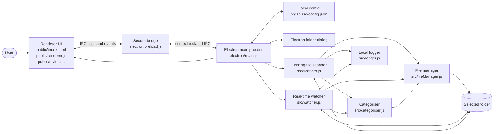
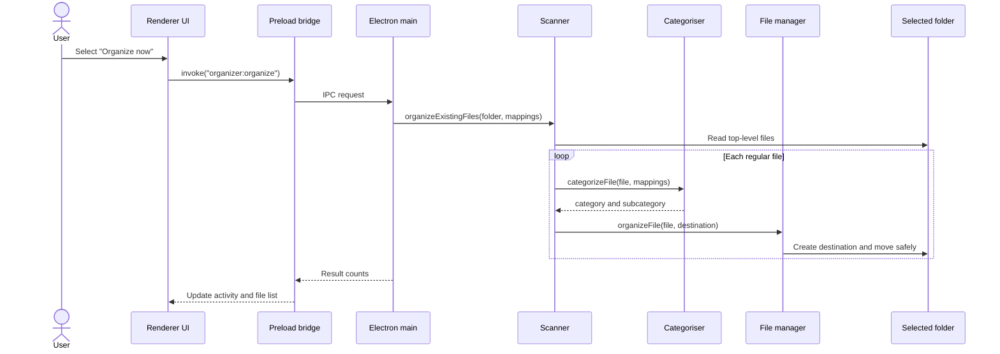
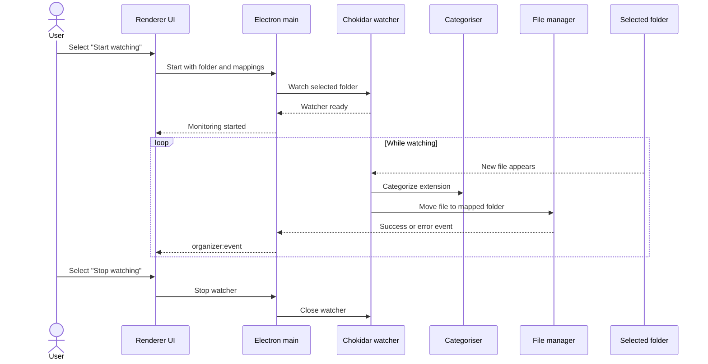
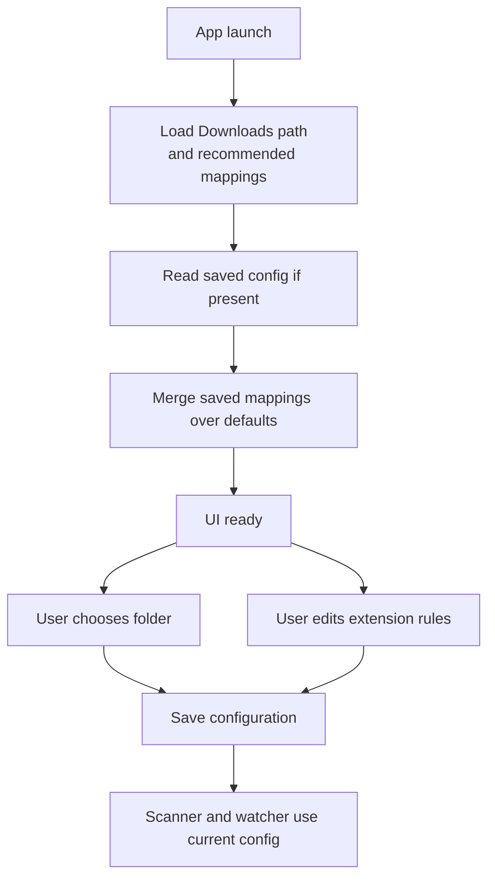

# Smart File Organizer

<div align="center">
  

  <h3>A friendly desktop app for turning folder chaos into clear categories.</h3>

  <a href="https://github.com/Vivek-code-xyz/FileOrganiser">
    
  </a>
  <a href="https://github.com/Vivek-code-xyz/FileOrganiser/issues">
    
  </a>
  
  
  

  <br><br>

  

  <p>
    <strong>Educational project</strong> · Local-first · No account · No cloud uploads
  </p>
</div>

Smart File Organizer is a local Electron desktop app for keeping a folder tidy. Choose a target folder, review the detected files, configure extension rules, organize existing files, or keep the folder organized in real time.

> **Built to learn by doing.** This project is intentionally approachable for students and developers learning Electron, IPC, file-system APIs, watchers, and desktop app packaging.

Files never leave the selected folder. The app creates destination folders inside it and uses unique names when a file with the same name already exists.

[**Download the Windows installer (.exe)**](https://github.com/Vivek-code-xyz/FileOrganiser/releases)

Open the latest GitHub release and download the installer from its **Assets** section. The packaged installer includes everything needed to run the app.

## What makes it useful

| ✨ Capability | What it demonstrates |
|---|---|
| **Organize now** | Safe file moves, extension categorization, and duplicate-name handling |
| **Start watching** | Real-time file-system events with Chokidar |
| **Edit rules** | User-configurable mappings persisted between launches |
| **Local-first design** | Electron main/preload/renderer boundaries and context isolation |
| **Windows packaging** | Building an installable `.exe` with Electron Builder |

## Tech stack

<div align="center">
  
</div>

## Features

- Uses the Windows `Downloads` folder by default.
- Lets you select any folder on your computer.
- Lists the selected folder's files, extensions, and sizes.
- Prefills recommended rules for documents, media, archives, and source code.
- Lets you edit the destination for each extension.
- Organizes existing files with **Organize now**.
- Watches for new files with **Start watching**.
- Remembers the selected folder and custom rules between launches.
- Ignores temporary download files such as `.crdownload`, `.part`, and `.tmp`.
- Runs locally without an account or cloud service.

## Project tags

`#electron` `#javascript` `#nodejs` `#desktop-app` `#file-organizer` `#windows` `#privacy-first` `#learning-project`

## Requirements

### Running the packaged Windows app

- Windows 10 or later, 64-bit
- No Node.js installation is required
- Access to the folder you want to organize

### Running from source

- Windows 10 or later, 64-bit
- Node.js 20 LTS or later
- npm 10 or later
- Git, optional, if cloning the repository

Node.js and npm are required only for running the project from source or building the Windows installer. They are not required after installing the packaged `.exe`.

Check your development tools:

```powershell
node --version
npm --version
```

## Install the `.exe` directly

The Windows installer is already available in the project's `release` folder:

```text
release\Smart File Organizer Setup 1.0.0.exe
```

To install it directly:

1. Open the project's `release` folder.
2. Double-click `Smart File Organizer Setup 1.0.0.exe`.
3. If Windows SmartScreen appears, select **More info**, verify that the publisher is expected, and choose **Run anyway** if you trust the build.
4. Choose the installation directory, or keep the default.
5. Select **Install**.
6. Launch **Smart File Organizer** from the Start menu or desktop shortcut.

The installer is not code-signed, so Windows may show a SmartScreen warning. This is expected for locally generated builds.

### Portable/unpacked build

For testing without running the installer, open:

```text
release\win-unpacked\Smart File Organizer.exe
```

Keep the complete `win-unpacked` folder together. Do not copy only the executable because it depends on the files beside it.

For users downloading the project from GitHub, open the repository's **Releases** page and download the installer attached to the latest release. Release builds are published automatically from version tags, and only the installer `.exe` is uploaded.

## Run from source

```powershell
git clone <repository-url>
cd smart-file-organiser
npm install
npm start
```

The first launch starts with the user's `Downloads` folder selected. Use **Choose folder** to select another directory.

Runtime events and organizer messages are written to the project-local `logs\events.log` file. Recent UI activities are also kept in `logs\activity.jsonl`, while `logs\organizer.log` contains operation messages. The `logs\` directory is ignored by Git.

## Build the Windows installer

Install dependencies and create a distributable installer:

```powershell
npm install
npm run dist
```

The generated installer is written to the `release/` directory. Run the `.exe` in that directory to install the application. The installer uses the custom Smart File Organizer icon.

To create an unpacked build for local testing:

```powershell
npm run pack
```

## Publish a release

Create and push a version tag to build and publish only the latest installer `.exe` to GitHub Releases:

```powershell
git tag v1.0.0
git push origin v1.0.0
```

The GitHub Actions workflow builds the tagged source and uploads only `Smart File Organizer Setup *.exe`. The `release/` build directory remains ignored by Git.

## How to use

1. Select **Choose folder** and pick the folder to organize.
2. Review the file list and detected extensions.
3. Select **Edit rules** if an extension should use a different destination.
4. Enter a folder path relative to the selected folder, such as `Codes/Python` or `Work/Invoices`.
5. Select **Save rules**.
6. Select **Organize now** to move files already in the folder.
7. Select **Start watching** to automatically process new files.
8. Select **Stop watching** before changing the target folder or when monitoring is no longer needed.

Destination paths are restricted to the selected folder. A rule cannot move files to an unrelated location.

## Default mappings

The recommended mappings include:

| Group | Examples | Destination |
|---|---|---|
| Documents | `.pdf`, `.docx`, `.txt`, `.xlsx` | `Documents/<type>` |
| Images | `.png`, `.jpg`, `.svg`, `.webp` | `Images/<type>` |
| Videos | `.mp4`, `.mkv`, `.mov` | `Videos/<type>` |
| Audio | `.mp3`, `.wav`, `.flac` | `Audio/<type>` |
| Archives | `.zip`, `.rar`, `.7z` | `Archives/<type>` |
| Code | `.html`, `.css`, `.js`, `.ts`, `.py`, `.java`, `.go`, `.rs` | `Codes/<language>` |
| Data/config | `.json`, `.xml`, `.yml`, `.yaml`, `.sql` | `Codes/<type>` |

Unknown extensions go to `Other` unless you add a custom rule for them.

## Data and privacy

The app does not upload files. It stores the selected folder and extension rules in Electron's per-user application data directory as `organizer-config.json`. Activity logs are written locally by the app.

## Project structure

```text
electron/
  main.js       Electron main process and IPC handlers
  preload.js    Secure renderer API
public/
  index.html    Application interface
  renderer.js   UI behavior
  style.css     UI styles
src/
  categoriser.js  Default and custom extension rules
  scanner.js      Existing-file scan
  watcher.js      Real-time folder watcher
  fileManager.js  Safe file moves
  logger.js       Local activity logging
assets/
  icon.png      Application icon source
  icon.ico      Windows installer icon
```

## Architecture

The app uses Electron's main/preload/renderer process split. File-system access stays in the main process; the renderer communicates through the small, context-isolated API exposed by `preload.js`.



### Organize existing files



### Real-time watching



### Configuration flow



## Development checks

```powershell
node --check electron\main.js
node --check public\renderer.js
node --check src\categoriser.js
npm start
```

## License

This is an **educational project** released under the **ISC License**, as declared in [`package.json`](package.json).

The ISC License permits you to use, copy, modify, and redistribute the project, including for commercial purposes, provided that the original copyright and permission notice remain included. The software is provided **as-is**, without warranties or guarantees. Review the full license text and add a `LICENSE` file before publishing a redistributed version.

> This README describes the intended license metadata; it is not legal advice.

---

<div align="center">
  <sub>Made for learning, experimenting, and keeping folders tidy.</sub>
</div>
